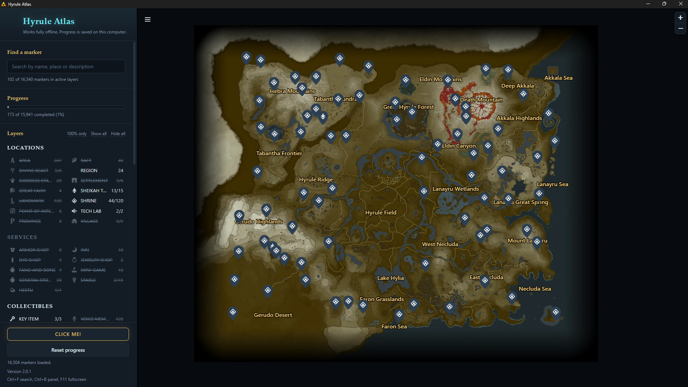
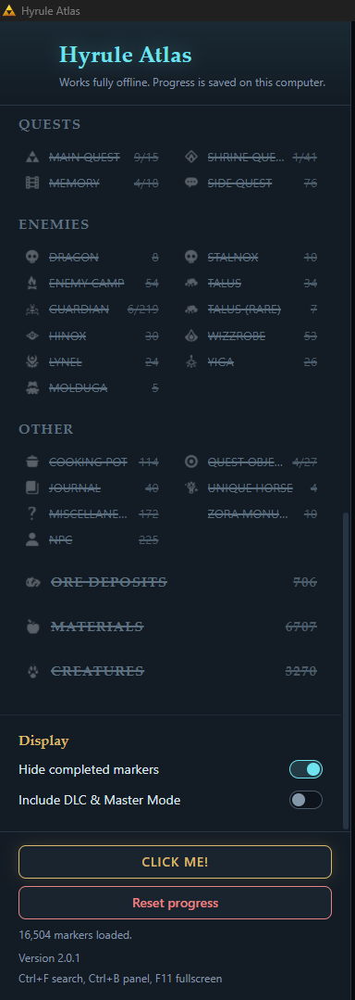
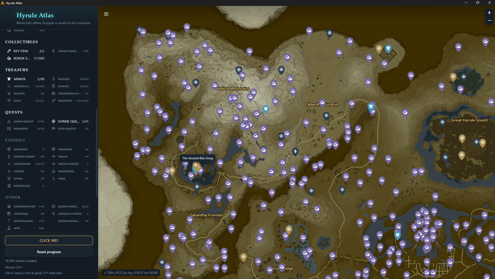
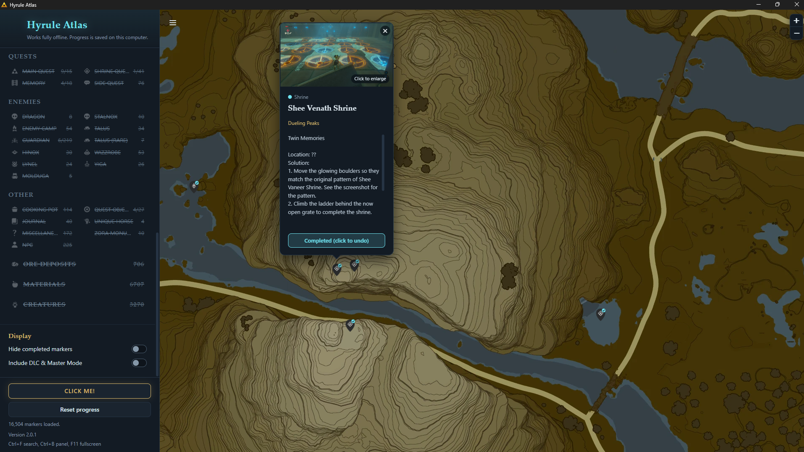
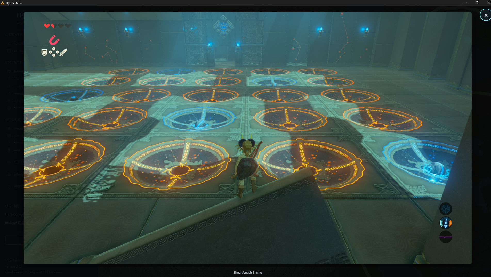

<h1 align="center">Hyrule Atlas</h1>

<p align="center"><b>A completely offline, interactive Breath of the Wild map and 100% completion tracker for Windows. No internet, no account, no subscription.</b></p>

<p align="center">
  
  
  
  
  
</p>

<p align="center">
  <a href="https://github.com/KyDaog/hyrule-atlas/releases/latest"><b>Download</b></a> ·
  <a href="https://www.youtube.com/kydaog">YouTube</a> ·
  <a href="https://discord.gg/gEWnBUtMrx">Discord</a>
</p>

<p align="center"></p>

---

## What is it?

Hyrule Atlas is a standalone desktop map for *The Legend of Zelda: Breath of the Wild*. Everything is bundled inside the app: the map, every marker and every screenshot. Open it on a plane, at a LAN party, or next to your Switch.

## Offline by design

Hyrule Atlas never needs the internet. Not to install it, not to run it, not to update your progress.

- **Everything is hosted locally.** The map tiles, all 16,504 markers, every icon and every screenshot ship inside the app. Nothing is loaded from a website.
- **No internet needed at all.** Unplug the cable, turn on airplane mode, it works the same.
- **No subscription, no account, no ads.** Free to use, with nothing to sign up for and nothing to renew.
- **Your saves stay on your machine.** Progress and settings are stored in a local folder on your PC (`%APPDATA%\Hyrule Atlas`). Nothing is uploaded, synced or shared.
- **Progress survives every update.** Install a new release over the old one and your checkmarks, layers and settings are still there. Uninstalling does not delete them either.

## Features

- **16,504 markers** across **59 categories**, including 136 shrines and 900 Korok Seeds.
- **Fully offline.** Everything is hosted locally, so no internet is ever needed. See [Offline by design](#offline-by-design).
- **Mark as Completed.** Click any marker, tick it off, and it is remembered on your PC between sessions and releases.
- **100% Completion preset.** One click shows only what the in-game completion counter tracks: shrines, Korok Seeds, Divine Beasts and landmarks.
- **Organised layer panel** with Locations, Services, Collectibles, Treasure, Quests, Enemies, Other, plus Ore Deposits, Materials and Creatures. Click a name to hide or show it, and expand groups for the detail.
- **Live search** across every marker title.
- **Include DLC & Master Mode** switch for the Champions' Ballad and Master Trials content.
- **Smooth on a big map.** A custom pin layer draws thousands of markers without lag, with pins that scale as you zoom.
- **Region and province names** drawn on the map as gold text, like in the game.
- **Screenshots inside popups** for the puzzle shrines, with click-to-enlarge.
- **Pins line up exactly.** Alignment is built in, with no calibration needed.

## Screenshots

<table>
  <tr>
    <td align="center"><br><sub>layer panel</sub></td>
    <td align="center"><br><sub>korok seeds</sub></td>
  </tr>
  <tr>
    <td align="center"><br><sub>shrine popup</sub></td>
    <td align="center"><br><sub>click to enlarge</sub></td>
  </tr>
</table>

## Roadmap

- Fill in the remaining puzzle screenshots for shrine and quest popups. This will take a while, because the Ocarina of Time remake is coming first.

Hyrule Atlas is complete and fully usable as it is today.

## Install

1. Open the [latest release](https://github.com/KyDaog/hyrule-atlas/releases/latest).
2. Download **Hyrule-Atlas-Setup-2.1.0.exe** and run it.
3. Choose Express or Custom install, and launch **Hyrule Atlas** from the Start menu or desktop.

Prefer no installer? Download **Hyrule-Atlas-Portable-2.1.0.zip**, unzip it anywhere, and run `Hyrule Atlas.exe`.

**Updating:** run the newer installer. It replaces the old version in the same folder and keeps your saved progress.

> **Windows SmartScreen:** the installer is not code-signed (certificates cost money), so Windows may show "Windows protected your PC". Click **More info**, then **Run anyway**.

## Where is my progress saved?

Only on your own computer, in `%APPDATA%\Hyrule Atlas`. It is never uploaded anywhere. Updating or uninstalling leaves it in place, so a new release or a reinstall picks up where you stopped. To back it up or move to another PC, copy that folder. Use **Reset progress** in the sidebar to clear it.

## Build from source

Requires [Node.js](https://nodejs.org) 20 or newer.

```bash
npm install
npm start            # run the app
npm run dev          # run with developer tools
npm run dist         # build the Windows installer into dist/
npm run dist:all     # installer + portable zip
```

Handy tools (run from the project folder):

| Command | What it does |
| --- | --- |
| `npm run tiles` | Cuts `hyrule_map.png` into map tiles |
| `npm run icon -- logo.png` | Makes `build/icon.ico` from a picture |
| `npm run format-data` | Re-formats `map_data.json` into readable lines |
| `npm run minify` | Compacts the app code (runs automatically on build) |
| `npm run github` | Rebuilds this README, LICENSE and release notes |

The map image and tiles are large and are not stored in the repository. See `.gitignore`.

## Made by KyDa

Built by KyDa, in coordination with Claude (an AI assistant made by Anthropic).

- YouTube: https://www.youtube.com/kydaog
- Discord: https://discord.gg/gEWnBUtMrx

## Disclaimer

Hyrule Atlas is an unofficial fan project and is not affiliated with or endorsed by Nintendo. *The Legend of Zelda* and *Breath of the Wild*, with their names, characters, maps and artwork, are the property of Nintendo. Marker data is based on community map projects. See [LICENSE](LICENSE) for the terms of use.
